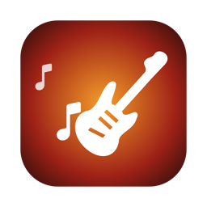
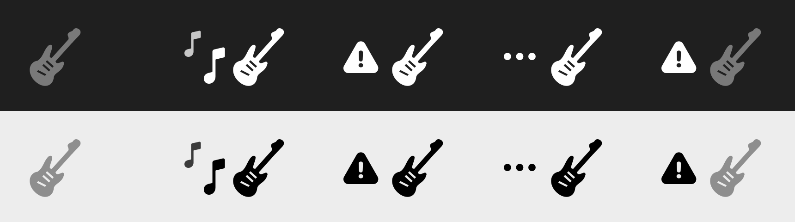

# JamTap



A macOS menu bar button that records what the Mac plays and saves it as an MP3.
Click the guitar to start a take, click again to stop.

JamTap records with [`catap`](https://github.com/sbetko/catap) (Core Audio process taps) and converts
with `ffmpeg`. It does nothing those two tools cannot do from a terminal; it removes the terminal.

## The icon



Left to right: idle, recording, recording but silent for 10 s, converting the last take.
While recording, the elapsed time shows to the left of the icon.

The silence warning means that `catap` has captured nothing above −60 dBFS for 10 seconds,
which usually means the sound goes somewhere the capture does not hear.

## Use

| Action | Effect |
|---|---|
| Left click | Start or stop a take |
| Right click (or Control-click) | Open the menu |
| Control-Option-Command-J | Start or stop a take, from any app |
| `pkill -USR1 -x JamTap` | Start or stop a take, from a script or a foot pedal |

A take is saved as `jam-YYYY-MM-DD_HHMM.mp3` in `~/Music/Jams/Solo`. The menu changes the folder,
opens it in Finder, plays one of the last five takes, and adds a label to the last take
(`jam-2026-11-02_2338 slow blues.mp3`).

The menu also chooses what is recorded:

- **Everything the Mac Plays**: one file with the whole output.
- **Only the Checked Apps, Mixed**: one file with only the apps checked below it.
- **Only the Checked Apps, One Track Each**: a folder named after the take with one file per app,
  for instance guitar and backing track apart. An app with several audio processes (a browser)
  gives one track per process; tracks that stayed silent are dropped.

**Stop Automatically** ends a take after a set time, in case it is forgotten.

Quitting while a take is recorded or converted finishes that take first.

## Install

Needs macOS 14 or later, the Swift toolchain (Xcode or the Command Line Tools), and both tools on
one of `~/.local/bin`, `/opt/homebrew/bin`, `/usr/local/bin`:

```sh
uv tool install catap
brew install ffmpeg
```

Then:

```sh
scripts/build-app.sh install   # builds build/JamTap.app and copies it to /Applications
open /Applications/JamTap.app
```

On the first take macOS asks whether JamTap may record system audio. The app is signed ad hoc
(without a developer certificate), so macOS may ask again after a rebuild.

## Limits

- Recording starts one to two seconds after the click, the time `catap` needs to start.
- On a MacBook with a full menu bar, macOS hides the icon behind the camera notch.
  The hotkey still works; removing other menu bar icons brings it back.
- The silence warning reads 16-bit recordings of a single file. Takes with one track per app are not monitored.
- The hotkey is fixed.

## Develop

```sh
scripts/test.sh                      # unit tests of Sources/JamTapCore
scripts/build-app.sh                 # build/JamTap.app
scripts/icon-sheet.sh docs/icon-sheet.png   # redraw the icon preview after changing StatusIcon.swift
```

`Sources/JamTapCore` holds the logic without AppKit (take names, command lines, WAV level, silence
detection) and is unit-tested. `Sources/JamTap` is the AppKit shell around it.
The output of `catap` and `ffmpeg` for the last take is in `~/Library/Logs/JamTap/`.
